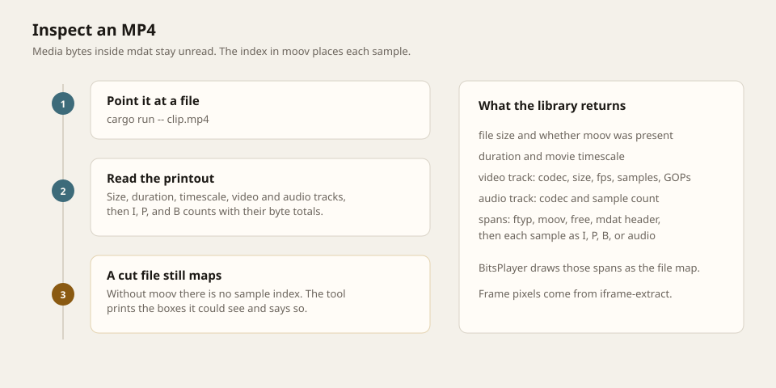
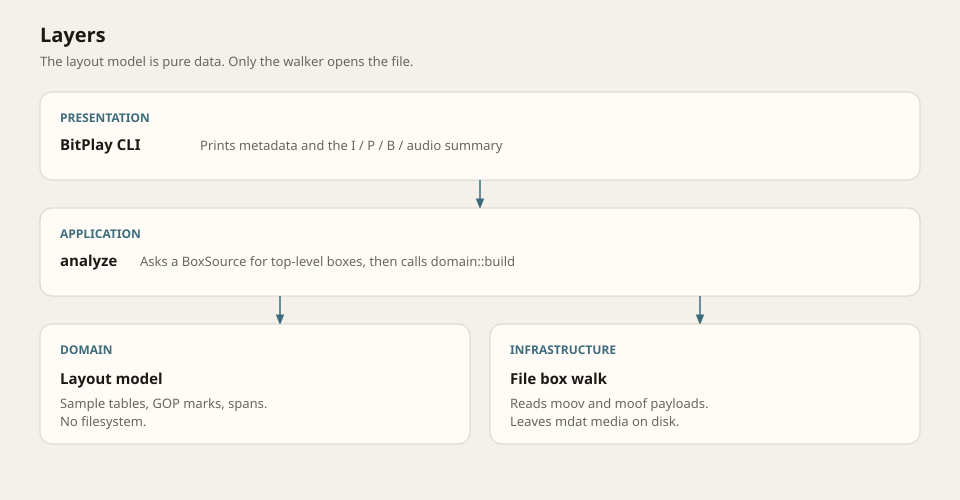
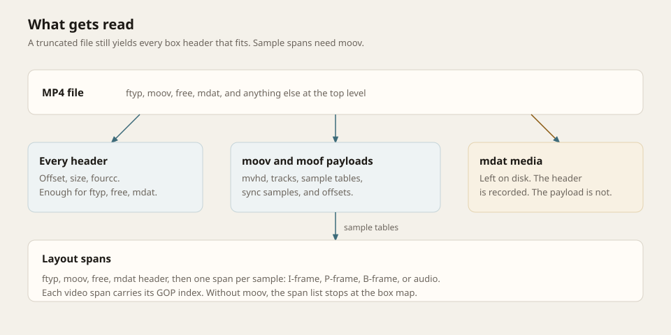

# BitPlay

BitPlay reads an MP4 and reports its layout: top-level boxes, track metadata, and where each sample sits in the file. It does this from the container index. The media bytes inside `mdat` stay on disk.

A file whose `moov` was cut off still produces a top-level box map, so a caller can see that the index is gone and hand the file to a carver. BitsPlayer uses this library for the Analyze view. The `BitPlay` binary prints the same analysis.

## Inspect a file



```bash
cargo run --release -- clip.mp4
```

The binary is `target/release/BitPlay`. It prints file size, duration, timescale, the video track (codec, resolution, frame rate, sample count, I-frame count, GOP count), the audio track when one is indexed, and byte totals for I, P, B, and audio samples.

When `moov` is absent the printout says the file looks truncated and points at iframe extraction.

## How the program is put together



| Layer | Role |
| --- | --- |
| `src/presentation/` | The CLI. Prints one `Analysis`. |
| `src/application/` | `analyze`. Asks a `BoxSource` for top-level boxes, then builds the layout. |
| `src/domain/` | Sample tables, GOP marks, and spans. No filesystem. |
| `src/infrastructure/` | Walks the file. Reads `moov` and `moof` payloads. Does not read `mdat` media. |

The library entry point is `bitplay::analyze`. The only runtime dependency is `anyhow`.

## What gets read



The walker seeks to each top-level box, reads its header, and records offset, size, and fourcc. For `moov` and `moof` it also reads the payload, clamped to the bytes that are actually in the file. For `mdat` it records the header and skips the payload.

`domain::build` turns a present `moov` into track info and one span per sample. Sync samples are I-frames. Other video samples are P or B from the composition timestamps. Audio samples are their own span. Each video span carries the GOP index it belongs to.

Without `moov`, the span list is the box map: `ftyp`, the `mdat` header, `free` / `skip` / `wide`, and anything else at the top level. `moov_present` is false. Duration and track info are absent.

## Build

```bash
cargo build --release
cargo test
```

`cargo test` includes a truncated file with `ftyp` and `mdat` and no `moov`, and checks that the box map still comes back.
